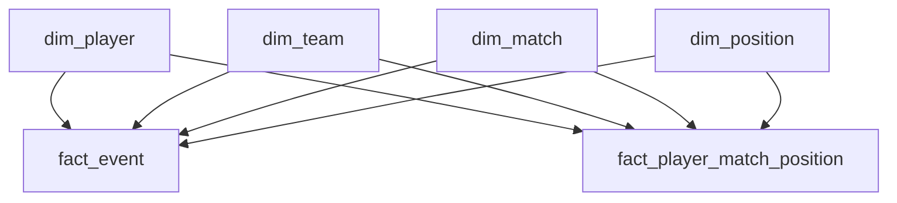

# Bundesliga Midfield Recruitment Analysis

**A football scouting portfolio project with Python, SQL Server and Power BI.**

Identify midfield candidates for further No.8 scouting using Bundesliga 2023/24 data. The project connects source-data validation, an independently calculated Python analysis, a dimensional SQL data warehouse and an interactive Power BI report.

**306 matches · 939,200 event records · 79 candidates · 58 meeting the half-season minutes rule**

> Historical screening for a specific scouting brief. The results guide further investigation; they do not establish overall player quality, current transfer availability or suitability for a particular club.

## The scouting question

Which midfield candidates combine successful forward passing, successful forward carrying and selected defensive activity? How does their ranking change when passing or carrying receives greater weight?

The report also profiles each player's playing time, pass outcomes, pass locations by pitch third, progression and defensive-action counts.

## Main findings

| Balanced rank | Player | Club(s) in 2023/24 | Balanced score | Best scenario rank | Worst scenario rank |
|---:|---|---|---:|---:|---:|
| 1 | Xaver Schlager | RasenBallsport Leipzig | 90.32 | 1 | 1 |
| 2 | Granit Xhaka | Bayer 04 Leverkusen | 88.99 | 1 | 2 |
| 3 | Anton Stach | 1. FSV Mainz 05 / TSG 1899 Hoffenheim | 85.25 | 3 | 4 |
| 4 | Emre Can | Borussia Dortmund | 83.42 | 3 | 6 |
| 5 | Kevin Stöger | VfL Bochum | 82.47 | 5 | 5 |

All five also meet the additional half-season participation rule. Schlager ranks first in every scenario. Xhaka has the highest successful-forward-passing rate among the candidates. Stach stands out for interception and loose-ball-regain activity. These observations need video review, tactical-role assessment and team context before any recruitment recommendation.

## Start here

- **View the report:** open [powerbi/bundesliga_midfield_scouting.pbix](powerbi/bundesliga_midfield_scouting.pbix) in Power BI Desktop. Imported data is included; a SQL connection is needed to refresh, not merely to view the saved report.
- **Understand the analysis:** read [notebooks/01_data_preparation_and_screening.ipynb](notebooks/01_data_preparation_and_screening.ipynb).
- **Understand the workflow:** [notebook guide](docs/NOTEBOOK_GUIDE.md), [data dictionary](docs/DATA_DICTIONARY.md) and [SQL execution guide](sql/README.md).
- **Review the project audit:** [AUDIT_REPORT.md](docs/AUDIT_REPORT.md) identifies what was missing, what changed and what was actually tested.

## Architecture

Python caches source JSON and loads five staging tables. SQL maps natural IDs to dimension keys, stores events and playing time in separate facts, and exposes analytical views. Power BI consumes those views.



The core warehouse is a **fact constellation**: two facts share four conformed dimensions. `dim_match` also references `dim_team` for home/away teams. This is more than a single central-fact star. Event counts and minutes are aggregated independently before combining them, avoiding duplicated playing time.

| Object | Grain / purpose |
|---|---|
| Five `staging` tables | Tabular player, team, match, position-duration and event source records |
| `analytics.dim_player`, `dim_team`, `dim_match`, `dim_position` | Shared reference dimensions with surrogate keys |
| `analytics.fact_event` | One match/provider event ID |
| `analytics.fact_player_match_position` | One match/team/player/position record |
| `analytics.vw_midfield_pool` | Eligible player-season and minutes |
| `analytics.vw_midfield_metrics` | Six action counts and their midfield per-90 rates |
| `analytics.vw_midfield_screening` | Percentiles, weighted scores and ranks |
| `analytics.vw_midfield_review` | Clubs, half-season minutes and scenario extremes |
| `analytics.vw_recruitment_dashboard` | One row per candidate-season for Power BI |
| Two `vw_player_profile_*` views | Profile summary and individual midfield passes |

An optional third fact, `fact_player_match_position_kpi`, and `dim_kpi` preserve six advanced provider metrics, their missing values and provenance. They do not change the core rankings.

## Data source and coverage

Source: [IMPECT Open Data](https://github.com/ImpectAPI/open-data), Bundesliga 2023/24, **iteration 743**. Match metadata, player/squad directories, event files and player-position aggregates are used together.

| Dataset | Snapshot count |
|---|---:|
| Teams / matches | 18 / 306 |
| Player directory / players with playing time | 570 / 494 |
| Position labels | 10 |
| Player-match-team-position duration rows | 10,577 |
| Event records | 939,200 |
| Eligible candidates / meeting both-half rule | 79 / 58 |
| Candidate midfield PASS events | 71,092 |

The supplied local cache contains 306 event files, 306 player-aggregate files and 17 targeted event-KPI files. Source metadata was added to the cache during project organization. The provider's current download URLs are used if files are absent; the repository records snapshot counts and source-file checksums to detect changes.

Raw data is approximately **1.1 GB** uncompressed and is excluded from Git. Keep your existing `data/raw/impect/` cache locally or let the preparation notebook download it. This lightweight repository archive does not duplicate the large raw dataset or generated checkpoints.

## Methodology

### Eligibility and exposure

Midfield includes `CENTRAL_MIDFIELD`, `DEFENSE_MIDFIELD` and `ATTACKING_MIDFIELD`. A candidate needs at least **900 midfield minutes** and a midfield share of at least **50% of total recorded playing time**. This gives 79 candidates; transferred players are combined across clubs.

The optional participation filter requires **450 midfield minutes in each season half**, matchdays 1–17 and 18–34. It identifies 58 candidates. It measures exposure across the season, not performance consistency.

### Actions and rates

All core action counts use events at recorded midfield positions. Their denominator is the corresponding midfield playing time:

`Rate per 90 = qualifying event count / midfield minutes × 90`

| Metric | Rule |
|---|---|
| Forward passing | PASS, provider SUCCESS, adjusted end_x − start_x ≥10 metres |
| Forward carrying | DRIBBLE, provider SUCCESS, the same forward-distance rule |
| Final-third entries | Successful pass/carry starting at x≤17.5 and ending at x>17.5 |
| Interceptions | INTERCEPTION events |
| Loose-ball regains | LOOSE_BALL_REGAIN events |

The adjusted coordinate convention points attack toward increasing x. DRIBBLE is the provider carrying category, not exclusively a take-on. A final-third entry need not additionally move 10 metres.

### Percentiles and rankings

Each rate is ranked among the 79 candidates using average ranks for ties:

`Percentile = 100 × average ascending rank / candidate count`

**A passing percentile of 100 means the highest forward-passing rate in this candidate pool. It does not mean 100% pass completion.**

Passing and carrying components use their respective forward-rate percentiles. Defensive activity is the average of the interception and loose-ball-regain rate percentiles. Final-third-entry metrics provide context but are not extra scoring terms.

| Scenario | Passing | Carrying | Defensive activity |
|---|---:|---:|---:|
| Balanced | 35% | 35% | 30% |
| Passing focus | 50% | 20% | 30% |
| Carrying focus | 20% | 50% | 30% |

Raw scores retain precision. Scenario ranks use scores rounded to **six decimals** to prevent numerical noise from splitting ties. Tied scores share a rank and subsequent positions can be skipped. Lower ranks are better; worst minus best rank measures sensitivity to these three weight choices. Report filters preserve the original 79-player benchmark.

## Power BI pages

| Page | Purpose |
|---|---|
| Candidate Overview | Candidate/exposure cards, player and club filters, ranked screening table |
| Player Comparison | Forward-pass versus forward-carry rates per 90 |
| Scenario Comparison | Alternative ranks and sensitivity range |
| Methodology | Definitions, scope and interpretation |
| Findings | Historical shortlist and next scouting steps |
| Player Profile | Minutes, matches, pass outcomes, origin/destination thirds and action totals |

The profile separates all-position playing time from midfield-only actions. The location charts show counts, not expected threat. Provider SUCCESS, NEUTRAL, FAIL and other/unknown results remain separate. The saved PBIX includes an optional advanced summary table, but these KPIs are not used in the published score.

## Python organization

```text
football-no8-recruitment/
├── notebooks/                 # Three main workflow notebooks
│   ├── exploration/           # Optional source history and one-match walkthrough
│   └── extensions/            # Optional advanced KPI analysis/import/validation
├── src/scouting/              # Shared paths, JSON cache, checkpoints, SQL connection
├── scripts/run_preparation.py # Script entry point for the same notebook logic
├── sql/                       # Complete numbered scripts 01–14 and execution guide
├── powerbi/                   # Current renamed PBIX and report notes
├── reports/                   # Generated CSV evidence and screenshot destination
├── docs/                      # Audit, dictionary, original-cell mapping and source manifest
├── data/                      # Local raw cache and generated checkpoints, ignored by Git
├── archive/                   # Untouched originals, ignored by Git
├── pyproject.toml
├── requirements.txt
└── README.md
```

Shared utilities are extracted into small modules; the analysis stays visible in notebooks for learning. Notebooks exchange explicit local checkpoints rather than depending on an old kernel. Every substantive cell from the original `ggg.ipynb` has a mapped destination; see [cell_mapping.csv](docs/cell_mapping.csv).

## Run locally

### Python setup

Use Python 3.11 or newer; the tested packaging environment is recorded in the audit.

```bash
python -m venv .venv
```

Activate the environment (`.venv\Scripts\activate` on Windows), then:

```bash
python -m pip install -r requirements.txt
python -m pip install -e .
python -m jupyterlab
```

Select this environment's Python kernel. Run **notebook 01** from top to bottom. It reads your cache or downloads absent files, calculates the reference analysis, saves `data/processed/core_analysis.pkl`, and exports CSV evidence to `reports/`. Optional script alternative:

```bash
python scripts/run_preparation.py
```

Allow time and memory for reading and flattening nearly one million events. The script and notebook use the same analytical cells, not two divergent implementations.

### SQL Server and Power BI

For an existing populated database, use SQL 10 and notebook 03 to validate; do not re-import staging. For a fresh database, follow [sql/README.md](sql/README.md): SQL 01–02 → Python staging import → SQL 03–10 → Python validation → SQL 14 for profiles.

Notebook 02 writes to SQL and defaults to `RUN_DATABASE_LOAD = False`. Enable it only for empty staging tables. It uses Windows integrated authentication and Microsoft ODBC Driver 17 or 18. Local configuration is in `src/scouting/config.py`; server/database can also be set through environment variables documented in `.env.example` (not automatically loaded).

The supplied scripts use `FootballRecruitmentDW`; changing the database name also requires updating their `USE` statements. Open the PBIX to view the saved report. Refresh requires the SQL views on your instance.

## Optional advanced KPI work

The six provider metrics are bypassed opponents, passing/carrying/set-piece/shooting pxT, and expected goal assists. They remain an extension, separate from the core ranking. There are 2,115 candidate position-match records, 12,690 long-form KPI records and 474 player-metric summaries; two missing shooting aggregates are supplemented from event exports.

Missing values are preserved, not assumed to be zero. Covered-period rates describe only records with values and can be unrepresentative. Full-season rates are shown only when all expected records have values. Negative pxT values are retained. The three extension notebooks and SQL 11–13 document the full path.

## Validation and practical limits

The original working database recorded 35 passing core SQL checks, nine advanced-view checks, three profile checks and successful Python/SQL reconciliation. The packaging audit reruns the raw-data Python analysis and optional advanced computations, checks saved PBIX data, validates notebook syntax/format and records results in [docs/AUDIT_REPORT.md](docs/AUDIT_REPORT.md).

A live SQL Server rebuild and native Power BI Desktop rendering were not available in the packaging environment. They are explicitly separate from the local checks; a clean source package is not a claim that every platform was freshly exercised.

## Limitations and future work

- Historical season and clubs; current cost and availability are outside scope.
- No possession, team-style or opposition adjustment; recorded positions do not prove comparable No.8 roles.
- Two defensive actions do not measure complete defensive quality.
- Weighting scenarios reflect the chosen brief, not objectively optimal recruitment weights.
- NO_VIDEO event periods mean record presence is not proof of complete observation.
- Creation/advanced KPI coverage is incomplete and excluded from the core score.
- Final report screenshots still need to be exported from the checked Desktop report.
- Packing zones, neutral-pass pressure context and threat-state analysis remain future additions, not implemented claims.

## Attribution

**Author: Mohamed Ben Abbes.** Independent football data analytics portfolio project. **Data credit: IMPECT Open Data.** Consult the provider's [documentation](https://github.com/ImpectAPI/open-data/blob/main/Documentation.pdf) and [data terms](https://github.com/ImpectAPI/open-data/blob/main/LICENSE.pdf) for reuse. No separate code license has been selected for this repository; the provider data remains governed by its own terms.
